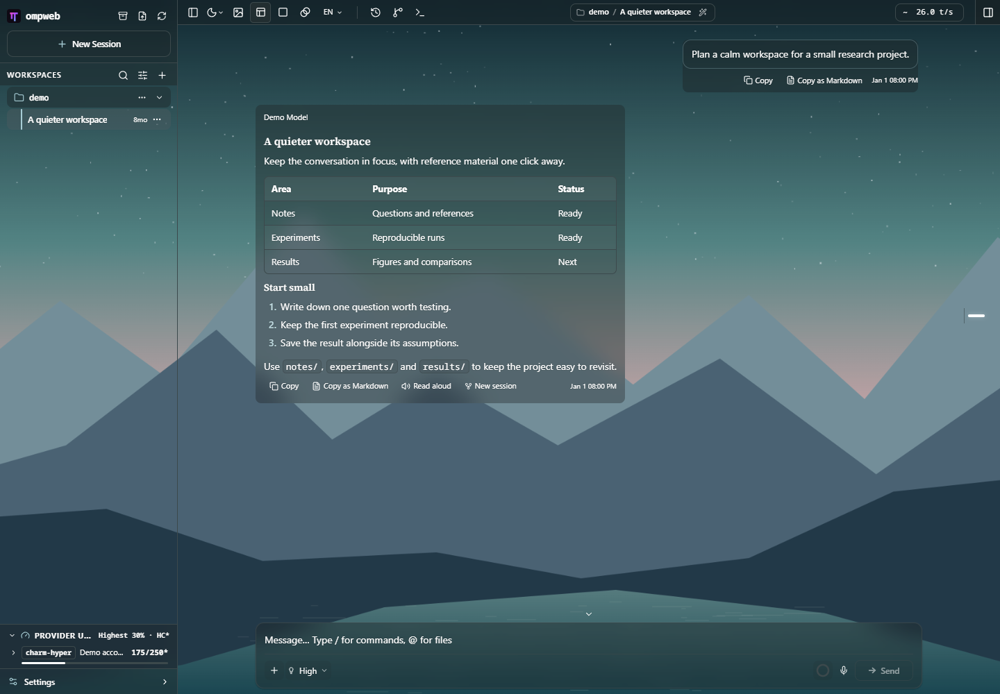

# ompweb

[English](./README.md) | [简体中文](./README.zh-CN.md) | [日本語](./README.ja.md)

[oh-my-pi (omp)](https://github.com/can1357/oh-my-pi) コーディングエージェント用のブラウザ
ワークスペースです。実行中のセッションとの対話、プロジェクト別の履歴閲覧、ファイル編集、
端末、omp 設定の管理ができます。

このリポジトリ（[hsiatein/ompweb](https://github.com/hsiatein/ompweb)）は
[kahme247/ompweb](https://github.com/kahme247/ompweb) のフォークで、
[`e822c7f`](https://github.com/kahme247/ompweb/commit/e822c7f) まで同期しています。
npm には公開していないため、ソースから導入してください。一部の機能には対応する omp フォーク
[hsiatein/oh-my-pi](https://github.com/hsiatein/oh-my-pi) が必要です。



## フォークでの追加

**ファイルとツール**
- テキストファイル（UTF-8、256 KiB 以下）の編集・保存と競合検出。エクスプローラーでの作成・名前変更・削除。
- 内蔵 PTY 端末（任意依存 `node-pty` のビルドが必要）。
- セッション・ファイル・メッセージ・コードブロックの右クリックメニュー。
- 返信中のローカルパス、`file://`、`artifact://` リンクをサイドパネルで開く。
- サーバー保存の[メモ](docs/memos.md)。

**対話と自動化**
- 予約送信と予約タスク（1 回 / 間隔 / 毎日 / 毎週 / webhook）。既存セッションまたは毎回新しいセッションへ送信。
- `scheduled_tasks` エージェントツール：エージェント自身の再開予約や、長いジョブ用の使い捨て webhook URL。
- 「対応が必要」ベル：全セッションの未回答の質問と sudo 要求をまとめて表示。
- エージェントのコマンドの sudo パスワードをブラウザのダイアログで入力（Linux）。
- 送信済みメッセージの編集はその手前で分岐。steer / follow-up の切り替えが正しく動作。

**アカウントとモデル**
- 厳密なプロバイダー/アカウントルーティング：全体の無効化とチャット単位の固定。
- アカウントのニックネームとアカウント別 HTTP(S) プロキシ。
- 独立した割当量プール、Codex/Claude の保存済みリセット、生成速度の履歴。
- 階層化カスタム指示（全体 → プロバイダー → モデル）。
- サブエージェント方針の設定（既定はオフ）。

**インターフェース**
- 変更可能なキーボードショートカット。Esc ではエージェントを停止しない。
- Alt 押下中の音声入力、セッションフィルター、ピン留めワークスペース、ディレクトリのお気に入り。
- 設定の再編成：インターフェースと動作、外観、モデルとプロバイダー、エージェントと方針、拡張とスキル。
- 画像/動画/Web 壁紙と Wallpaper Engine シーンの部分的な描画（[制約](docs/local-wallpapers.md)）、ガラス表示、壁紙由来の配色、[ペット](docs/PETS.md)。

**運用**
- システムパネル（セッション別のメモリ/CPU）と、空きメモリ不足時に最大のエージェント/端末コマンドを停止するメモリガード。
- 段階的な Linux デプロイスクリプト（`scripts/deploy-linux-service.sh`）。
- UI からの omp 更新は無効。omp はソースから管理。

詳細・制約・方針：[docs/CUSTOMIZATIONS.md](docs/CUSTOMIZATIONS.md)。
変更履歴：[CHANGELOG.md](CHANGELOG.md)。

## 必要条件

- `omp` が `PATH` 上にあること（または `OMP_WEB_OMP_BIN`）
- Node.js 22.19.0 以上

## インストール

```bash
git clone https://github.com/hsiatein/ompweb.git
cd ompweb
npm ci
npm run build
node bin/omp-web.js --no-open
```

<http://127.0.0.1:30177> を開きます。

既存の Linux サービス（`~/.local/share/ompweb`）の更新：

```bash
scripts/deploy-linux-service.sh          # staging コピーをビルド。サービスは稼働継続
scripts/deploy-linux-service.sh switch   # 切り替えて再起動（実行中のエージェントは停止）
```

### CLI

```bash
node bin/omp-web.js --port 8080
node bin/omp-web.js --hostname 0.0.0.0
node bin/omp-web.js --password "secret"
node bin/omp-web.js --no-open
node bin/omp-web.js --help
```

パスワードなしで loopback 以外にバインドした場合、プライベート LAN/VPN のクライアントのみ受け付けます。
同じホスト上のトンネルやリバースプロキシはこの確認を回避するため、信頼できるネットワーク外では
パスワードと HTTPS を使ってください。

サービスインストーラー（Windows トレイ、macOS launchd、Linux systemd/トレイ）は上流のもので、
上流の npm パッケージを導入します。[上流 README](https://github.com/kahme247/ompweb#readme) を参照してください。

## 環境変数

| 変数 | 説明 | 既定値 |
| --- | --- | --- |
| `PORT` | サーバーポート | `30177` |
| `OMP_WEB_HOSTNAME` | バインドアドレス | `127.0.0.1` |
| `OMP_WEB_PASSWORD` | Web ログインのパスワード | なし |
| `OMP_WEB_NO_OPEN` | `1` = ブラウザを自動で開かない | `0` |
| `OMP_WEB_DISABLE_AUTOUPDATE` | `1` = ompweb 自身の更新確認を無効化 | `0` |
| `OMP_WEB_OMP_BIN` | `omp` のパス | 自動 |
| `PI_CODING_AGENT_DIR` | omp エージェントディレクトリ | `~/.omp/agent` |
| `OMP_WEB_PORT` | エージェント webhook URL のポート（開発サーバーは `30178`） | `PORT` または `30177` |
| `OMP_WEB_STT_ENDPOINT` / `_KEY` / `_MODEL` | 音声入力用の OpenAI 互換文字起こし API | 無効 |
| `OMP_WEB_FFMPEG_BIN` / `OMP_WEB_FFPROBE_BIN` | 壁紙 BGM の抽出用 | `PATH` から検索 |
| `OMP_WEB_WALLPAPER_DIRS` | 壁紙ルート。空なら Steam 自動検出を無効化 | Steam 自動検出 |
| `OMP_WEB_WALLPAPER_ASSETS` | 追加の Wallpaper Engine アセットルート | 自動 |
| `OMP_WEB_WALLPAPER_CACHE_MB` | シーン変換キャッシュの容量（`0` で無効） | `4096` |
| `OMP_WEB_CODEX_PETS_DIR` | Codex ペットのディレクトリ | `~/.codex/pets` |

## 開発

```bash
npm install
npm run dev         # http://127.0.0.1:30178
npm run typecheck
npm run lint
npm test
```

開発サーバーの使用中に `npm run build` を実行しないでください。`.next/` が上書きされます。

## ライセンス

MIT。[kahme247/ompweb](https://github.com/kahme247/ompweb) を基にしており、元は
[agegr/pi-web](https://github.com/agegr/pi-web) のフォークです。
