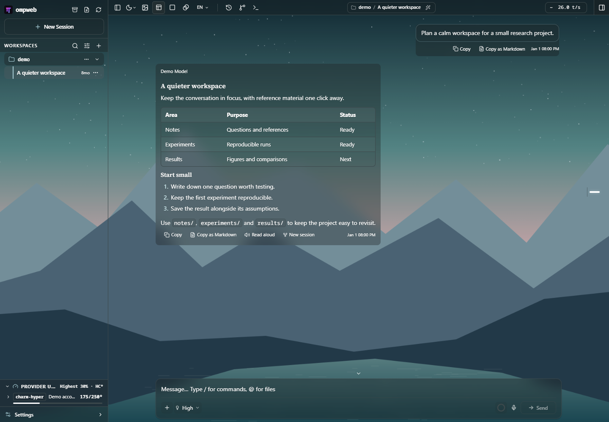

# ompweb

[English](./README.md) | [简体中文](./README.zh-CN.md) | [日本語](./README.ja.md)

A browser workspace for the [oh-my-pi (omp)](https://github.com/can1357/oh-my-pi)
coding agent: chat with live sessions, browse past ones by project, edit files,
run terminals and manage omp settings.

This repository ([hsiatein/ompweb](https://github.com/hsiatein/ompweb)) is a fork
of [kahme247/ompweb](https://github.com/kahme247/ompweb), synced through
[`e822c7f`](https://github.com/kahme247/ompweb/commit/e822c7f). It is not
published to npm — install from source. Some features need the paired omp fork,
[hsiatein/oh-my-pi](https://github.com/hsiatein/oh-my-pi).



## What the fork adds

**Files and tools**
- Edit and save text files (UTF-8, ≤ 256 KiB) with conflict detection; create, rename and delete in the Explorer.
- Integrated PTY terminal (needs the optional `node-pty` build).
- Right-click menus across sessions, files, messages and code blocks.
- Local paths, `file://` and `artifact://` links in replies open in the side panel.
- Server-side [memos](docs/memos.md).

**Conversations and automation**
- Send later, and scheduled tasks (once / interval / daily / weekly / webhook) into an existing or a fresh session.
- `scheduled_tasks` agent tool: an agent can schedule its own wake-up or get a one-shot webhook URL for a long job.
- "Needs you" bell collecting pending questions and sudo prompts from all sessions.
- Browser sudo password dialog for agent commands (Linux).
- Editing a sent message forks before it; working steer/follow-up promotion.

**Accounts and models**
- Strict provider/account routing: global disables plus per-chat pins.
- Account nicknames and per-account HTTP(S) proxies.
- Separate quota pools, Codex/Claude saved rate-limit resets, generation-speed history.
- Scoped custom instructions (global → provider → model).
- Configurable subagent policy (off by default).

**Interface**
- Rebindable keyboard shortcuts; Esc no longer stops the agent.
- Alt push-to-talk dictation, session filters, pinned workspaces, directory favorites.
- Reorganized settings: Interface & Behavior, Appearance, Models & Providers, Agents & Policies, Extensions & Skills.
- Image/video/web wallpapers and partial Wallpaper Engine scene rendering ([limits](docs/local-wallpapers.md)), glass surfaces, wallpaper-derived colors, animated [pets](docs/PETS.md).

**Operations**
- System panel (memory/CPU per session) and a memory guard that stops the largest agent/terminal command when free memory runs low.
- Staged Linux deployment script (`scripts/deploy-linux-service.sh`).
- omp updates from inside the UI are disabled; omp is maintained from source.

Details, limits and policy notes: [docs/CUSTOMIZATIONS.md](docs/CUSTOMIZATIONS.md).
History: [CHANGELOG.md](CHANGELOG.md).

## Requirements

- `omp` on `PATH` (or `OMP_WEB_OMP_BIN`)
- Node.js ≥ 22.19.0

## Install

```bash
git clone https://github.com/hsiatein/ompweb.git
cd ompweb
npm ci
npm run build
node bin/omp-web.js --no-open
```

Open <http://127.0.0.1:30177>.

Updating an existing Linux service install (`~/.local/share/ompweb`):

```bash
scripts/deploy-linux-service.sh          # build a staged copy; service keeps running
scripts/deploy-linux-service.sh switch   # restart onto it (stops running agents)
```

### CLI

```bash
node bin/omp-web.js --port 8080
node bin/omp-web.js --hostname 0.0.0.0
node bin/omp-web.js --password "secret"
node bin/omp-web.js --no-open
node bin/omp-web.js --help
```

Without a password, non-loopback binds only accept private LAN/VPN clients. A
tunnel or reverse proxy on the same host bypasses that check — set a password
and use HTTPS for anything beyond a trusted network.

Service installers (Windows tray, macOS launchd, Linux systemd/tray) come from
upstream and install the upstream npm package; see the
[upstream README](https://github.com/kahme247/ompweb#readme).

## Environment variables

| Variable | Description | Default |
| --- | --- | --- |
| `PORT` | Server port | `30177` |
| `OMP_WEB_HOSTNAME` | Bind host | `127.0.0.1` |
| `OMP_WEB_PASSWORD` | Web login password | none |
| `OMP_WEB_NO_OPEN` | `1` = don't open a browser | `0` |
| `OMP_WEB_DISABLE_AUTOUPDATE` | `1` = disable ompweb's own update check | `0` |
| `OMP_WEB_OMP_BIN` | Path to `omp` | auto |
| `PI_CODING_AGENT_DIR` | omp agent directory | `~/.omp/agent` |
| `OMP_WEB_PORT` | Port used in agent webhook URLs (dev: `30178`) | `PORT` or `30177` |
| `OMP_WEB_STT_ENDPOINT` / `_KEY` / `_MODEL` | OpenAI-compatible transcription for dictation | disabled |
| `OMP_WEB_FFMPEG_BIN` / `OMP_WEB_FFPROBE_BIN` | For wallpaper background-music extraction | from `PATH` |
| `OMP_WEB_WALLPAPER_DIRS` | Wallpaper roots; empty disables Steam discovery | Steam auto-discovery |
| `OMP_WEB_WALLPAPER_ASSETS` | Extra Wallpaper Engine asset roots | auto |
| `OMP_WEB_WALLPAPER_CACHE_MB` | Compiled scene cache size (`0` disables) | `4096` |
| `OMP_WEB_CODEX_PETS_DIR` | Codex pet directory | `~/.codex/pets` |

## Development

```bash
npm install
npm run dev         # http://127.0.0.1:30178
npm run typecheck
npm run lint
npm test
```

Don't run `npm run build` while the dev server is in use — it overwrites `.next/`.

## License

MIT. Based on [kahme247/ompweb](https://github.com/kahme247/ompweb), originally
forked from [agegr/pi-web](https://github.com/agegr/pi-web).
