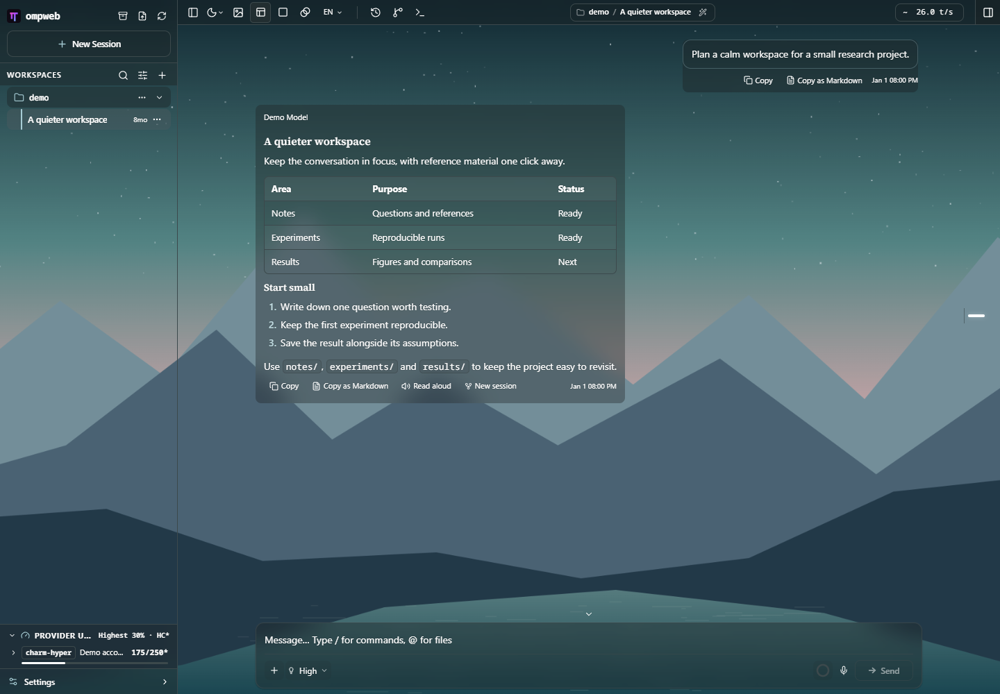

# ompweb

[English](./README.md) | [简体中文](./README.zh-CN.md) | [日本語](./README.ja.md)

[oh-my-pi (omp)](https://github.com/can1357/oh-my-pi) 编程智能体的浏览器工作台：
与运行中的会话对话、按项目浏览历史会话、编辑文件、使用终端、管理 omp 设置。

本仓库（[hsiatein/ompweb](https://github.com/hsiatein/ompweb)）是
[kahme247/ompweb](https://github.com/kahme247/ompweb) 的分支，已同步至
[`e822c7f`](https://github.com/kahme247/ompweb/commit/e822c7f)。未发布到 npm，请从源码安装。
部分功能需要配套的 omp 分支 [hsiatein/oh-my-pi](https://github.com/hsiatein/oh-my-pi)。



## 本分支新增

**文件与工具**
- 编辑并保存文本文件（UTF-8，≤ 256 KiB），带冲突检测；资源管理器中新建、重命名、删除。
- 内置 PTY 终端（需要可选依赖 `node-pty` 编译成功）。
- 会话、文件、消息、代码块的右键菜单。
- 回复中的本地路径、`file://`、`artifact://` 链接可在侧栏打开。
- 服务端[备忘录](docs/memos.md)。

**对话与自动化**
- 定时发送；定时任务（一次 / 间隔 / 每天 / 每周 / webhook），投递到已有会话或每次新建会话。
- `scheduled_tasks` 智能体工具：智能体可给自己定时唤醒，或为长任务申请一次性 webhook URL。
- “需要你”提醒铃：汇总所有会话中待回答的问题和 sudo 请求。
- 智能体命令的 sudo 密码在浏览器弹窗中输入（Linux）。
- 编辑已发送消息会在其之前分叉；steer / follow-up 提升可正常工作。

**账号与模型**
- 严格的 provider/账号路由：全局禁用 + 单个对话固定。
- 账号昵称、按账号设置 HTTP(S) 代理。
- 独立额度池、Codex/Claude 已存重置次数、生成速度历史。
- 分层自定义指令（全局 → provider → 模型）。
- 可配置的子智能体策略（默认关闭）。

**界面**
- 可自定义快捷键；Esc 不再停止智能体。
- Alt 按住说话听写、会话筛选、置顶工作区、目录收藏。
- 设置重新分组：界面与行为、外观、模型与 Provider、智能体与策略、扩展与技能。
- 图片/视频/网页壁纸及部分 Wallpaper Engine 场景渲染（[限制](docs/local-wallpapers.md)）、毛玻璃界面、壁纸取色、[桌宠](docs/PETS.md)。

**运维**
- 系统面板（按会话显示内存/CPU）和内存守护：可用内存过低时终止最大的智能体/终端命令。
- 分阶段 Linux 部署脚本（`scripts/deploy-linux-service.sh`）。
- 禁用界面内的 omp 更新；omp 从源码维护。

细节、限制与策略说明：[docs/CUSTOMIZATIONS.md](docs/CUSTOMIZATIONS.md)。
变更记录：[CHANGELOG.md](CHANGELOG.md)。

## 环境要求

- `omp` 在 `PATH` 中（或设置 `OMP_WEB_OMP_BIN`）
- Node.js ≥ 22.19.0

## 安装

```bash
git clone https://github.com/hsiatein/ompweb.git
cd ompweb
npm ci
npm run build
node bin/omp-web.js --no-open
```

打开 <http://127.0.0.1:30177>。

更新已有的 Linux 服务安装（`~/.local/share/ompweb`）：

```bash
scripts/deploy-linux-service.sh          # 构建 staging 副本，服务继续运行
scripts/deploy-linux-service.sh switch   # 切换并重启（会停止运行中的智能体）
```

### 命令行

```bash
node bin/omp-web.js --port 8080
node bin/omp-web.js --hostname 0.0.0.0
node bin/omp-web.js --password "secret"
node bin/omp-web.js --no-open
node bin/omp-web.js --help
```

未设置密码时，非 loopback 绑定只接受私有局域网/VPN 客户端。同机的隧道或反向代理会绕过这项检查——
超出可信网络时请设置密码并使用 HTTPS。

服务安装器（Windows 托盘、macOS launchd、Linux systemd/托盘）来自上游，安装的是上游 npm 包，见
[上游 README](https://github.com/kahme247/ompweb#readme)。

## 环境变量

| 变量 | 说明 | 默认值 |
| --- | --- | --- |
| `PORT` | 服务端口 | `30177` |
| `OMP_WEB_HOSTNAME` | 绑定地址 | `127.0.0.1` |
| `OMP_WEB_PASSWORD` | 网页登录密码 | 无 |
| `OMP_WEB_NO_OPEN` | `1` = 不自动打开浏览器 | `0` |
| `OMP_WEB_DISABLE_AUTOUPDATE` | `1` = 关闭 ompweb 自身的更新检查 | `0` |
| `OMP_WEB_OMP_BIN` | `omp` 路径 | 自动 |
| `PI_CODING_AGENT_DIR` | omp agent 目录 | `~/.omp/agent` |
| `OMP_WEB_PORT` | 智能体 webhook URL 使用的端口（开发服务器设为 `30178`） | `PORT` 或 `30177` |
| `OMP_WEB_STT_ENDPOINT` / `_KEY` / `_MODEL` | 听写用的 OpenAI 兼容转写接口 | 关闭 |
| `OMP_WEB_FFMPEG_BIN` / `OMP_WEB_FFPROBE_BIN` | 提取壁纸背景音乐 | `PATH` 中查找 |
| `OMP_WEB_WALLPAPER_DIRS` | 壁纸根目录；留空则关闭 Steam 自动发现 | Steam 自动发现 |
| `OMP_WEB_WALLPAPER_ASSETS` | 额外的 Wallpaper Engine 资源目录 | 自动 |
| `OMP_WEB_WALLPAPER_CACHE_MB` | 场景编译缓存大小（`0` 关闭） | `4096` |
| `OMP_WEB_CODEX_PETS_DIR` | Codex 桌宠目录 | `~/.codex/pets` |

## 开发

```bash
npm install
npm run dev         # http://127.0.0.1:30178
npm run typecheck
npm run lint
npm test
```

开发服务器运行期间不要执行 `npm run build`——它会覆盖 `.next/`。

## 许可证

MIT。基于 [kahme247/ompweb](https://github.com/kahme247/ompweb)，最初分叉自
[agegr/pi-web](https://github.com/agegr/pi-web)。
